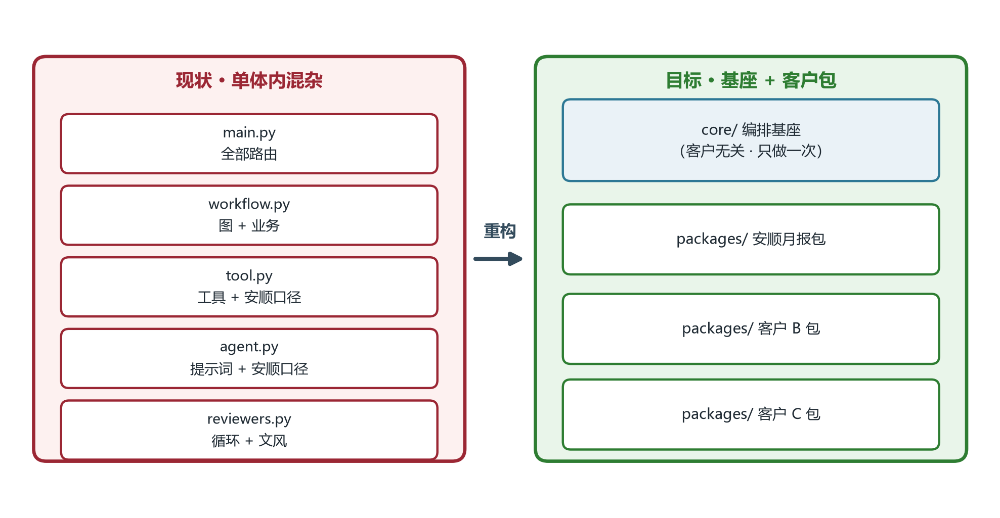
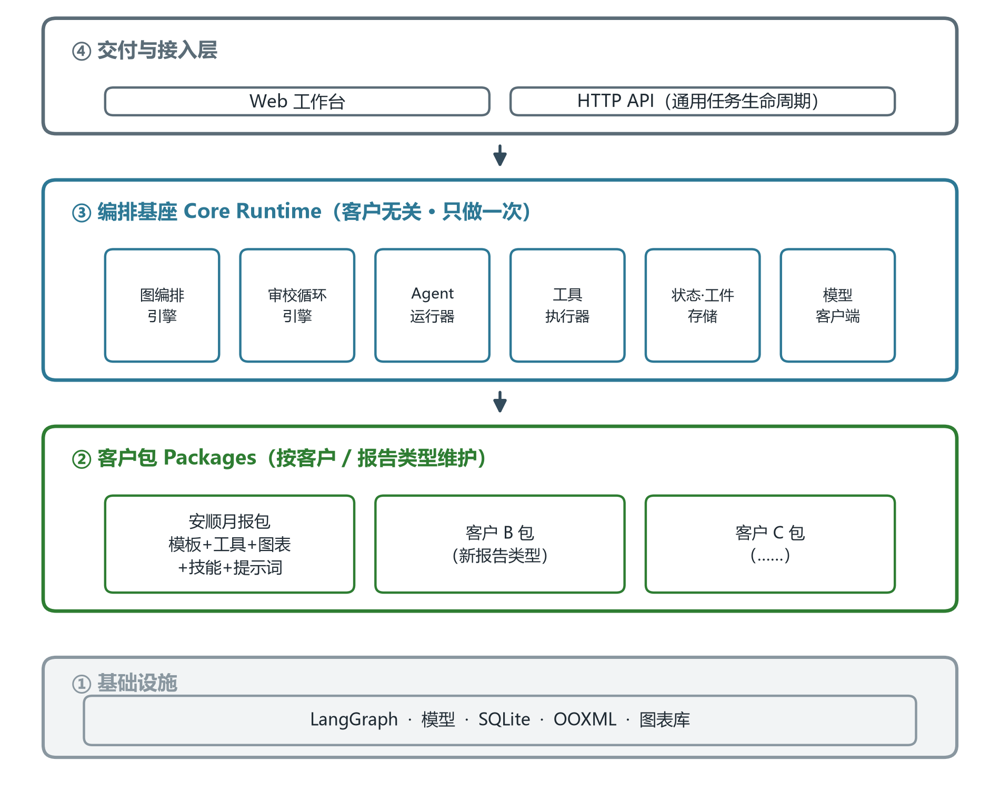
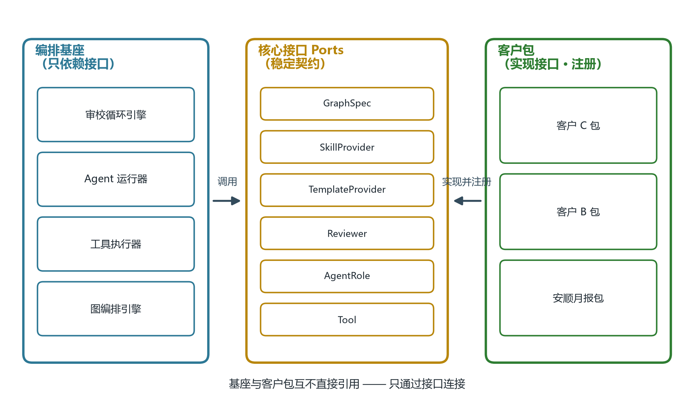
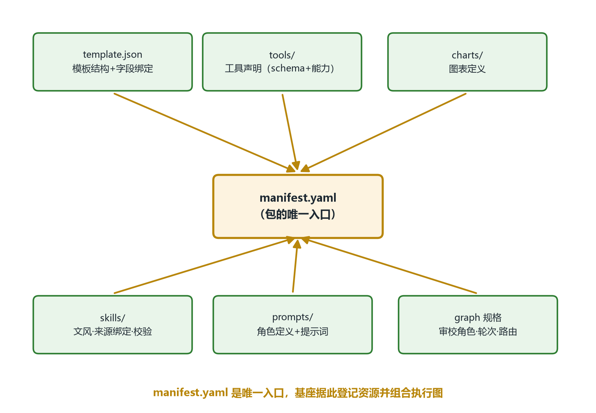
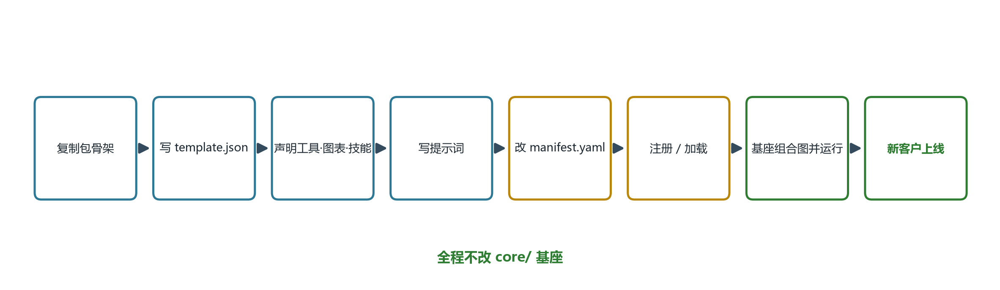

# 报告工作台架构重构框架（建议）

> 目标：把「编排基座」与「客户技能库 / 提示词」彻底分离。基座只做一次、长期稳定；面对不同客户的报告需求时，只需**新增一个客户包**（模板 + 工具 + 图表 + 技能 + 提示词），不改动基座代码。

---

## 1. 现状诊断：为闭环而「混」在了一起

| 现文件 | 本该通用 | 却混入了安顺口径 |
|---|---|---|
| `app/tool.py` | 工具声明与处理器 | 列名 `标题/舆情调性`、`CLUSTER_TERMS` 分类词典、`resolve_locality` 安顺区县、`render_chart` 图表标题 |
| `app/tool_executor.py` | 通用执行器 | 写死 `filter_records` 范围白名单、writer 只读工具名单、`import_records` 路径校验分支 |
| `app/agent.py` | Agent 定义与提示词 | 40+ 条提示词全是「安顺舆情月报」业务（`ANALYSIS_PROMPT`/`OUTLOOK_PROMPT`…） |
| `app/workflow.py` | 图编排 | 报告图 + 写作图 + 业务节点动作（`_process_records`/`_write_draft`）写死 |
| `app/reviewers.py` | 审校循环引擎 | 写死 `format/content` 双审角色 + 去AI文风技能 |
| `app/main.py` | 通用 API | 766 行：报告/模板/图表/写作审核/计费全量路由 |
| `app/structured_writer.py` 等 | — | Writer 循环与模板校验、来源绑定、风格技能耦合 |

> 好消息：`ToolSpec`（`required_capabilities`/`produced_capabilities`/版本号）与 `REPORT_PROMPT_PROFILES` 已经是「声明式契约 + 提示词画像」的雏形 —— 重构是**抽出注册表、把业务搬到客户包**，不是推翻重来。



---

## 2. 目标架构总览（四层）



**核心主张**：第③层是稳定基座，第②层是可变资产。客户越多，只涨第②层，第③层不动。

---

## 3. 核心原则：依赖倒置 + 注册表（只依赖接口）



**规则**：基座只 import 接口；客户包只 import 接口并把自己注册进去；二者互不直接引用。新增客户 = 新增一个「实现接口的包」，编译期与运行期都不碰基座。

---

## 4. 目录结构（基座 / 客户包）

```text
report-platform/
├─ core/                        # ③ 编排基座（客户无关，长期稳定）
│  ├─ ports.py                  #    核心接口契约（Tool/AgentRole/Reviewer/...）
│  ├─ registry.py               #    通用注册表（按包名 + 能力登记）
│  ├─ runtime/
│  │  ├─ graph.py               #    图编排引擎（内置通用「审校循环」模式）
│  │  ├─ executor.py            #    工具执行器（声明式契约 + 进程隔离 + 幂等）
│  │  ├─ agent.py               #    Agent 运行器（角色 + 提示词 + Schema）
│  │  ├─ model_client.py        #    模型客户端
│  │  └─ store.py               #    状态 / 工件 / 事件存储
│  └─ api/                      #    通用任务生命周期路由
│
└─ packages/                    # ② 客户包（按客户/报告类型维护）
   ├─ anshun_monthly/
   │  ├─ manifest.yaml          #   声明：模板/工具/图表/技能/审校角色/图规格
   │  ├─ template.json          #   结构化模板（blocks + fields + bindings + rules）
   │  ├─ tools/                 #   计算·取数·图表工具（含 args schema）
   │  ├─ charts/                #   图表定义（类型 + 数据绑定 + 样式）
   │  ├─ skills/                #   文风/去AI、来源绑定、校验规则
   │  └─ prompts/               #   角色定义 + 提示词（版本化）
   └─ customer_b/
      └─ ...
```

---

## 5. 客户包解剖：`manifest.yaml` 是唯一入口



基座启动/加载时读取 `manifest.yaml`，把包内资源登记进注册表，并按 `graph 规格` 组合出该客户的执行图。

---

## 6. 新客户接入流程（不动基座）



---

## 7. 核心接口契约（Ports）

| 接口 | 职责 | 客户包实现示例 |
|---|---|---|
| `Tool` | `name` + JSON Schema 入参 + `required/produced capabilities` + `mutates_facts` + 处理器 | `import_records` / `render_chart` |
| `AgentRole` | `role_id` + 职责/边界 + 输出 Schema | `writer` / `format_reviewer` |
| `Reviewer` | 审校角色 + 路由规则 + 轮次预算 | `format_reviewer` / `content_reviewer` |
| `TemplateProvider` | 结构化模板 + 字段绑定 + `validate_values` | `anshun_monthly/template.json` |
| `SkillProvider` | 文风/去AI、来源绑定、校验规则 | `lieflat-less-ai-tone` |
| `ChartProvider` | 图表类型 + 数据绑定 + 样式 | `sentiment` / `daily` / `platform` |
| `GraphSpec` | 节点/顺序/条件路由声明 | 写作图规格（审校循环） |

> 现有 `ToolSpec`（含能力依赖）与 `REPORT_PROMPT_PROFILES` 可直接演进为 `Tool` / `AgentRole` + `prompts/` 文件化。

---

## 8. 迁移路径（分四阶段，不破坏现有 demo）

| 阶段 | 动作 | 结果 |
|---|---|---|
| **P1 抽资产** | 把 `tool.py` 的安顺工具 + `agent.py` 的提示词，物理迁入 `packages/anshun_monthly/`；`core/registry` 统一登记 | 工具、提示词文件化、按包可替换 |
| **P2 抽执行器** | 删除 `tool_executor.py` 里的业务白名单分支，改为只认 `Tool` 声明契约（能力门禁/幂等/隔离通用化） | 执行器彻底客户无关 |
| **P3 抽图编排** | `workflow.py` 的写作图改为读 `GraphSpec`；审校循环抽成 `core` 通用模式 | 加客户 = 改图规格，不改引擎 |
| **P4 抽 API + 多包验证** | `main.py` 收拢为通用任务生命周期；再造第二个客户包（如「政务周报」）跑通回归 | 用第二个包证明「只加包、不动基座」 |

> 建议顺序：P1 → P2 → P3 → P4，每阶段都跑现有 196 项测试 + 新增一个「第二客户包」的冒烟用例作回归护栏。

---

## 9. 收益与风险

**收益**
- 新客户/新报告类型只增一个包，基座零改动 → 交付提速、回归面缩小。
- 提示词/模板/工具可独立版本化、独立发布、独立回滚。
- 基座与业务解耦后，模型、图引擎、存储可独立升级。

**风险与对策**
- 迁移期回归：按阶段切，每阶段测试门禁兜底（保留现有 `app/` 作为过渡、包逐步接管）。
- 注册表一致性：`manifest.yaml` 作为唯一真相，加载时做契约校验（缺能力/缺引用即失败）。
- 提示词版本管理：`prompts/` 文件化后按 fingerprint 校验，机器稿随提示词变更自动重写。
