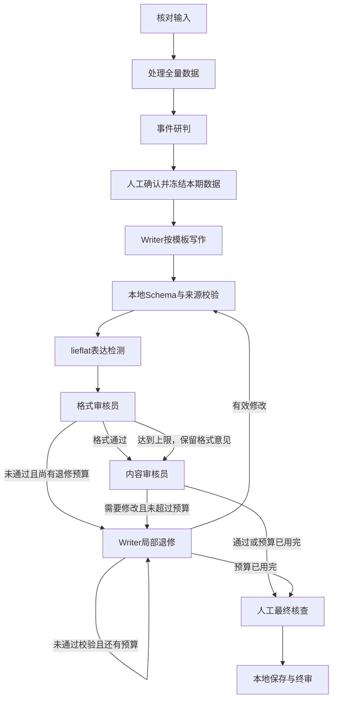

# 真实 LangGraph 双审核与表达修订

## 回滚基线与实现范围

按用户已回滚后的源码继续，未采用 Kimi 遗留文档作为实现证据。改动前的 app、tests、scripts 及哈希保存在 `backups/pre-review-graph-20261108-164807`。

报告处理与写作现在分别使用实际编译并执行的图，节点会记录开始、完成或失败事件。模板比对仍保持原有实现，本次没有声称它已全部拆分。

数据人工确认前后由现有 TaskStore 和 API 保存阶段，不依赖一次长连接。格式未通过时不直接调用内容审核；先退修并复核格式。达到上限后保留全部遗留格式意见，继续内容审核，最后统一交终稿人审。格式上限放行不等于格式通过，遗留阻断项依然阻止终审。当前自动流程最多三轮审核循环、总共两次 Writer 退修；结构错误会带着错误反馈重试，但消耗同一退修预算，不额外无限循环。模型响应的定位、引用和 Schema 最多纠正三次；网络失败与无效响应均保留失败结果，不伪装审核通过。

## 提示词与 skill

- 所有本项目角色提示词仍在 `app/agent.py`，包括 `format_reviewer.review`、`content_reviewer.review`、`writer.revise`、`style.application`。
- `app/reviewers.py` 负责数据传递、有限循环、结果持久化与哈希门禁；`state.py` 约束结构；`style_skill.py` 运行检测，不散落角色提示词。
- 已安装项目内 [lieflat-less-ai-tone](../skills/lieflat-less-ai-tone/SKILL.md)，来源为 [官方仓库](https://github.com/larashero3-dotcom/lieflat-less-ai-tone)，固定提交 `53160078a04926d98de57a233549612d1b89bdc9`，保留 CC BY-NC 4.0 许可及 `PROJECT-PROVENANCE.json`。调用时实际加载规则、封闭语义判据并运行原始 `detect.py`。
- 原 skill 的中途确认交互按用户已授权的自动写作流程调整：检测和改写依据留痕，人工在最后核查。保留信息守恒、最小修改以及 C/H/X 只报告或保留的边界。统计指标不作为 AI 作者鉴定或“生成概率”。

第二部分此前存在互相冲突的指令：主提示词要求自然正文，`writer.analysis_output` 却仍要求“程序合成为300—500字”。现已统一：`paragraph` 为模型直接写出的正文，风险链与信号等结构字段用于内部审计；不能省略正文依靠字段拼接。保留严肃公文表达，避免把去 AI 味误解为口语化。

真实运行还修正了三项接口问题：同年 `YYYY-02` 与 `2月` 的等价日期不再误拒；明确前瞻窗口的日期不冒充历史计数；审核员可用 `quote_catalog` 的原句编号定位，程序准确取回原文，不接受省略号拼接。错误反馈一次包含本轮全部定位和引用问题。

## 人工终结与数据保护

1. 审核员只针对机器文字提出修改；固定模板、数据字段、人工确认的归并/分类/TOP10作为只读参照。
2. `human_edit` 正文不再发回模型；Writer 不能修改数据字段、人工终稿、图表或其他未授权字段。
3. 风格修订保留事实数字、不确定性和列表条数。空字段、错误来源、失效哈希、超出 Schema 的修改均拒绝，保留上一版有效稿。
4. 退修或阻断意见未处理时不能终审。`warning/report_only` 是提示，不凭空增加人工阻断。
5. 人工修订字段后，本地更新有效稿哈希并处理该字段意见；人工核对后保留原文也有专门入口。均不调用模型。原模型审查哈希与人工生效哈希分别留痕。

## 页面入口

任务详情 → **双审核与人工终审**。可查看两位审核员状态、原句、理由、修改建议、检测前后记录、实际图节点轨迹。

需要修改时展开“人工最终修订”，按字段一次保存；工作建议保留多段编辑。需要保留原文时填写核查说明，点击对应意见的“已核对，保留当前内容”。字段与图表完整、阻断项处理后开放“确认报告并终审”。技术错误默认折叠，完整调用留在日志。

API：`GET /api/workflow-graphs`、`GET /api/tasks/{id}/writing-review`、`POST /api/tasks/{id}/review-draft`、`POST /api/tasks/{id}/writing-review/resolve`。现有 `slot-values` 接口用于人工终稿。

## 验证与真实结果

开发真实试跑保存在 `data/review-graph-20261108-*`。最新完整结果在 `data/review-graph-20261108-173213/continued-result.json`，不是模拟适配器结果。它实际经过独立的格式/内容审核、一次有效 Writer 退修和第二轮双审核；第二次退修遗漏必需的 `issue_ids`，程序拒绝，进入最终人工核查。

当前已填齐 34 个字段、五张图表；冻结事实、数据字段、人工内容和原图表引用保持。最终规则已按用户补充改为：先格式，格式未通过先退修，达到上限后保留意见并进入内容审核。真实副本实际验证了格式退修预算用尽后的内容审核调用，最终保留13条意见（11条阻断、2条提示），统一展示在终稿人审页。当前真实任务 d2511637 已导入这份完整稿及审查工件，没有替用户终审。

审核确实发现过正文把仅7条的“互动栏目”与10183条的移动客户端并列为主要渠道的问题；也发现方法标签、判断强度、口语以及格式衔接问题。每次模型意见都留在不可变工件中，最终人审不能将“字段填齐”当作“内容质量通过”。格式环节达到上限既不隐藏遗留意见，也不将状态伪装成通过。

浏览器隔离副本验收通过：两位审核员及原句可见；人工修改、核对保留后才开放终审；新增模型请求为0，页面脚本错误为0。截图 `data/writing-review-before-ui.png`、`data/writing-review-after-human-ui.png` 为明确模拟人工操作的隔离副本，没有改动用户的人工结论。

Token 监测沿用实际响应 usage。四份开发验证快照共81次响应，输入1,559,302、输出98,678 Token，按当前工作台单价估算约1.103283元；这是开发验证消耗，不是一次正常报告的固定费用。明细为 `data/review-graph-usage-20261108.json`；最新验证副本的33次响应约0.534091元，导入真实任务时标记 `writing_validation`，避免当成正式生成时长。

全套回归结果与当前服务验证在任务计划中记录。

生产页面只读验收：格式达到上限的提示、两位审核员及13条遗留意见均可见，终审门禁关闭，脚本错误0。截图 data/writing-review-live-limit-ui.png 与 data/writing-review-live-finding-ui.png。导入前保存原任务状态至 backups/before-verified-review-review-graph-20261108-173213.json。

回归：97项通过（373.81秒）；最后门禁专项12项通过（包含随后新增的“无效格式退修达到上限仍进入内容审”用例），月份等价表示保护用例单独通过。8765服务已加载最终代码，PID21048；8877隔离服务已关闭。
